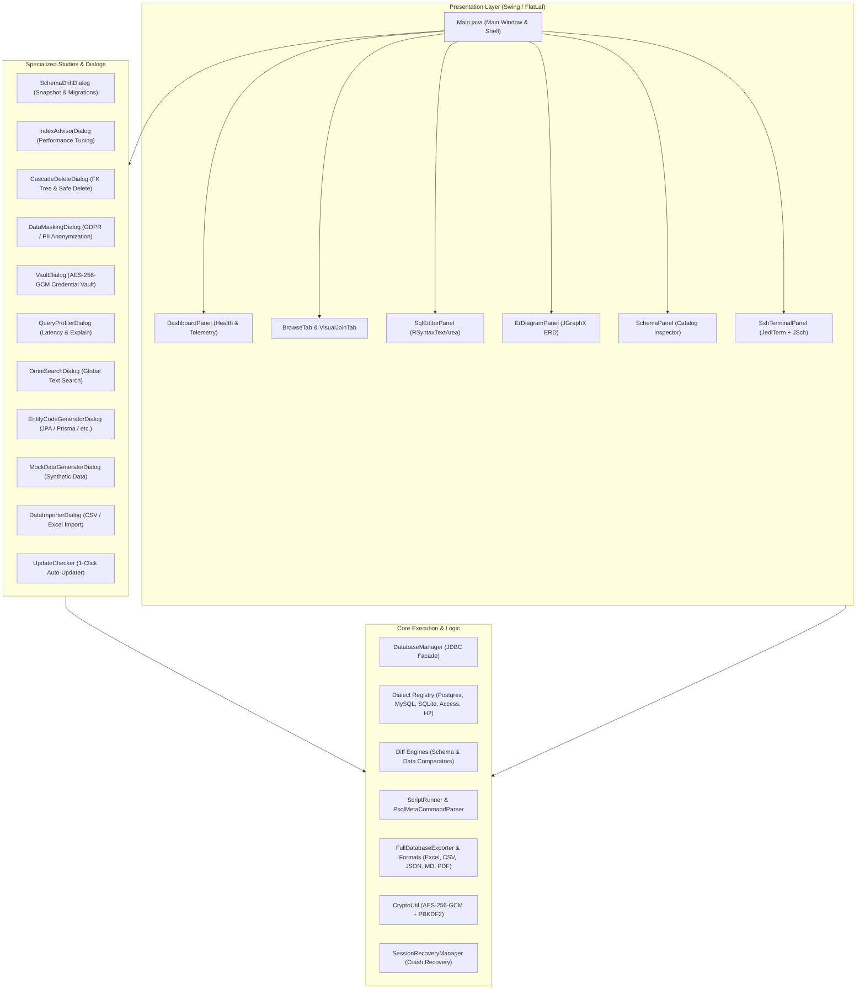

# SchemaSync — Codebase, Feature & Technology Architecture Map

**Version:** 1.6.4  
**Created & Developed by:** NSENGIYUMVA Christophe  
*Copyright © 2026 NSENGIYUMVA Christophe. All rights reserved.*

---

## 1. High-Level System Architecture

SchemaSync is organized into distinct, clean layers separating UI presentation, workflow dialogs, database engine drivers/dialects, data/schema diff engines, serialization & export, and utility infrastructure.



---

## 2. Directory & Package Layout

```
D:\projects\DBTOOL\
├── pom.xml                                   # Maven POM: Dependencies, plugins (Shade, Launch4j)
├── installer.iss                             # Inno Setup 6.4.1 installer script
├── README.md                                 # Official product documentation & features
├── CODEBASE_MAP.md                           # This architecture and feature mapping document
├── release\                                  # Build output folder
│   ├── schemasync_1.6.7_all.deb              # Ubuntu Desktop DEB Package (Pure Java / Commons Compress)
│   ├── schemasync-1.6.7-1.fc44.noarch.rpm    # Fedora 44 Linux RPM Package (Redline RPM)
│   ├── SchemaSync-Setup.exe                  # Windows Setup Installer (Inno Setup)
│   ├── SchemaSync.exe                        # Windows Standalone Native Executable (Launch4j)
│   └── SchemaSync.jar                        # Shaded Cross-Platform Fat JAR
└── src\
    ├── main\
    │   ├── resources\
    │   │   ├── icons\app.ico                 # Application taskbar & installer icon
    │   │   └── com\dbtool\icons\             # Vector & bitmap UI icons
    │   └── java\com\dbtool\
    │       ├── Main.java                     # Application entry point, main window & toolbar
    │       ├── DatabaseManager.java          # Primary JDBC engine & connection manager
    │       │
    │       ├── core\                         # Core database & pipeline services
    │       │   ├── config\                   # AppSettings, SettingsManager
    │       │   ├── connection\               # ConnectionManager, ConnectionPool, SshTunnelManager, JdbcUrlBuilder
    │       │   ├── dialect\                  # Multi-engine SQL dialects (Postgres, MySQL, SQLite, Access, H2)
    │       │   ├── diff\                     # Schema & Data diff engines, DDL generators, Sync SQL
    │       │   ├── exception\                # Custom typed exceptions
    │       │   ├── export\                   # Multi-format streaming exporters (Excel, CSV, JSON, Markdown, SQL)
    │       │   ├── inspector\                # JDBC schema metadata extractor & CatalogCache
    │       │   ├── model\                    # Table, Column, Index, FK, and Connection metadata models
    │       │   ├── query\                    # Paging query builders, QueryExecutor, ValueFormatter, SqlSanitizer
    │       │   └── script\                   # SQL statement splitter, PSQL meta-commands, Variable replacer
    │       │
    │       ├── model\                        # Application workspace & state models (SessionSnapshot, VisualJoinState)
    │       │
    │       ├── panels\                       # Main UI tabs, dialogs, and studios
    │       │   ├── DashboardPanel.java       # Executive Database Overview & Live Telemetry
    │       │   ├── DataMaskingDialog.java    # Sensitive Data Masking & Anonymization Studio
    │       │   ├── VaultDialog.java          # AES-256-GCM Credential Vault Dialog
    │       │   ├── QueryProfilerDialog.java  # SQL Latency Profiler & Bottleneck Analyzer
    │       │   ├── ErDiagramPanel.java       # Interactive JGraphX ER Diagram Canvas
    │       │   ├── IndexAdvisorDialog.java   # Performance & Index Advisor
    │       │   ├── SchemaDriftDialog.java    # Schema Snapshot, Drift Detector & Migration Studio
    │       │   ├── CascadeDeleteDialog.java  # Recursive FK Inspector & Safe Cascade Delete
    │       │   ├── EntityCodeGeneratorDialog.java # ORM & Entity Code Generator
    │       │   ├── MockDataGeneratorDialog.java   # Synthetic Mock Data Generator
    │       │   ├── DataImporterDialog.java   # CSV / Excel Drag & Drop Importer
    │       │   ├── OmniSearchDialog.java     # Global Database Spotlight OmniSearch
    │       │   ├── SqlEditorPanel.java       # RSyntaxTextArea SQL Query Editor & Runner
    │       │   ├── SchemaPanel.java          # Left-sidebar interactive schema tree & context actions
    │       │   ├── ConnectionManagerDialog.java # Saved Connection Profiles & Credential Vault trigger
    │       │   ├── SshTerminalPanel.java     # JediTerm + JSch integrated SSH Terminal
    │       │   ├── DataChartDialog.java      # Interactive Swing Data Visualizer & Charting
    │       │   ├── ScriptBuilderPanel.java   # Multi-step SQL Migration Script Workbench
    │       │   ├── TableComparePanel.java    # Two-query dataset comparator
    │       │   ├── DualDatabaseComparePanel.java # Live dual-database schema & data comparator
    │       │   ├── ActivityMonitorPanel.java # Live DB server thread & session activity monitor
    │       │   ├── DependencyGraphPanel.java # Visual schema dependency graph
    │       │   ├── WorkspacesPanel.java      # Multi-workspace organizer
    │       │   ├── QueryLogPanel.java        # Live query execution event stream (bottom dock)
    │       │   ├── DatabaseAuditorDialog.java # 1-Click Health & Performance Diagnostic Audit
    │       │   ├── RecoveryDialog.java       # Crash recovery & session restoration prompt
    │       │   ├── MultiTabContainer.java    # Reusable multi-tab pane for Browse and Join tabs
    │       ├── packaging\                    # Native Linux packaging engines
    │       │   └── FedoraRpmPackager.java    # Pure Java Fedora 44 RPM builder with .desktop and icon integration
    │       │
    │       ├── ui\                           # Reusable UI widgets and renderers
    │       │   ├── SplashScreen.java         # High-resolution application boot splash screen
    │       │   └── components\               # CustomTable, DiffRenderer, FilterTextField, PagingToolbar, StatusBar
    │       │
    │       ├── packaging\                    # Native Linux distribution packaging engines
│       │   ├── UbuntuDebPackager.java    # Ubuntu Desktop DEB package builder (Pure Java / Commons Compress)
│       │   └── FedoraRpmPackager.java    # Fedora 44 RPM package builder (Redline RPM)
│       │
│       └── util\                         # Helper utilities
    │           ├── UpdateChecker.java        # 1-Click In-App Auto-Updater, silent restarter & download manager
    │           ├── CryptoUtil.java           # Military-grade AES-256-GCM + PBKDF2 encryption utility
    │           ├── ThemeManager.java         # FlatMac Dark/Light mode theme engine & listeners
    │           ├── SessionRecoveryManager.java # Background autosave daemon & crash recovery
    │           ├── QueryLogger.java          # Ring-buffer query execution telemetry logger
    │           ├── SqlFormatter.java         # Multi-line indented SQL query beautifier
    │           ├── SqlSnippetsLibrary.java   # 15+ built-in SQL query patterns and templates
    │           ├── VisualJoinProjectManager.java # Visual query join canvas serialization
    │           └── ExportUtil.java           # PDF, Excel, and CSV multi-grid export helpers
    └── test\                                 # 134 automated unit and integration tests (JUnit 5)
```

---

## 3. Comprehensive Feature-to-Code Mapping

| Feature | Primary Java File(s) | Key Methods & Classes | Location in Code |
| :--- | :--- | :--- | :--- |
| **⚡ 1-Click In-App Auto-Updater** | `UpdateChecker.java`<br>`UpdateCheckerTest.java` | `checkForUpdates()`, `showUpdateDialog()`, `isNewerVersion()` | `src/main/java/com/dbtool/util/UpdateChecker.java:30-360` |
| **🏠 Database Overview & Health Dashboard** | `DashboardPanel.java`<br>`Main.java` | `DashboardPanel`, `refresh()`, `loadCatalogStats()` | `src/main/java/com/dbtool/panels/DashboardPanel.java:1-320`<br>`Main.java:3744-3756` (Tab 0) |
| **🔒 Sensitive Data Masking Studio** | `DataMaskingDialog.java`<br>`DataMaskingTest.java` | `applyMask()`, `detectPiiCategory()`, `exportMaskedData()` | `src/main/java/com/dbtool/panels/DataMaskingDialog.java:1-420`<br>`Main.java:4016` |
| **🛡️ AES-256-GCM Credential Vault** | `CryptoUtil.java`<br>`VaultDialog.java`<br>`CryptoUtilTest.java` | `encryptPassword()`, `decryptPassword()`, `exportVault()`, `importVault()` | `src/main/java/com/dbtool/util/CryptoUtil.java:1-180`<br>`src/main/java/com/dbtool/panels/VaultDialog.java:1-290` |
| **⏱️ SQL Query Profiler & Bottleneck Analyzer** | `QueryProfilerDialog.java`<br>`QueryLogger.java` | `QueryProfilerDialog`, `runExplain()`, `QueryLogger.logQuery()` | `src/main/java/com/dbtool/panels/QueryProfilerDialog.java:1-260`<br>`src/main/java/com/dbtool/util/QueryLogger.java:1-75` |
| **📐 Interactive ER Diagram Visualizer** | `ErDiagramPanel.java`<br>`DatabaseManager.java` | `buildGraph()`, `exportToImage()`, `exportToMermaid()`, `applyLayout()` | `src/main/java/com/dbtool/panels/ErDiagramPanel.java:1-550`<br>`Main.java:3774` |
| **⚡ Performance & Index Advisor** | `IndexAdvisorDialog.java` | `analyze()`, `findUnindexedForeignKeys()`, `findRedundantIndexes()` | `src/main/java/com/dbtool/panels/IndexAdvisorDialog.java:1-380`<br>`Main.java:3678` |
| **📐 Schema Snapshot, Drift & Migration** | `SchemaDriftDialog.java`<br>`DdlMigrationGenerator.java` | `captureSnapshot()`, `compareSnapshots()`, `generateUpMigration()`, `generateDownMigration()` | `src/main/java/com/dbtool/panels/SchemaDriftDialog.java:1-450`<br>`Main.java:3689` |
| **⚡ FK Dependency Tree & Cascade Delete** | `CascadeDeleteDialog.java` | `buildDependencyTree()`, `executeCascadeDelete()`, `generatePreviewSql()` | `src/main/java/com/dbtool/panels/CascadeDeleteDialog.java:1-360`<br>`Main.java:865` |
| **💻 Instant ORM & Entity Code Generator** | `EntityCodeGeneratorDialog.java` | `generateCode()`, JPA, Prisma, Drizzle, SQLAlchemy, Pydantic, EF Core | `src/main/java/com/dbtool/panels/EntityCodeGeneratorDialog.java:1-440`<br>`Main.java:878` |
| **🧪 Synthetic Mock Data Generator** | `MockDataGeneratorDialog.java` | `generateMockRows()`, `sampleForeignKeys()`, `executeBatchInsert()` | `src/main/java/com/dbtool/panels/MockDataGeneratorDialog.java:1-390`<br>`Main.java:887` |
| **📥 Drag & Drop CSV / Excel Importer** | `DataImporterDialog.java` | `parseFile()`, `autoMapColumns()`, `executeBatchImport()` | `src/main/java/com/dbtool/panels/DataImporterDialog.java:1-410`<br>`Main.java:892` |
| **🔍 Database OmniSearch (`Ctrl+Shift+F`)** | `OmniSearchDialog.java` | `startSearch()`, `searchTable()`, `jumpToTableRecord()` | `src/main/java/com/dbtool/panels/OmniSearchDialog.java:1-350`<br>`Main.java:3702, 3962` |
| **📊 Interactive Data Charting** | `DataChartDialog.java` | `createChart()`, Bar / Line / Pie renderers, export PNG | `src/main/java/com/dbtool/panels/DataChartDialog.java:1-280`<br>`Main.java:286` |
| **🧩 Visual Join Builder** | `Main.java` (`VisualJoinTab`)<br>`VisualJoinProjectManager.java` | `rebuildJoinSql()`, `exportJson()`, `importJson()`, `JoinRowPanel` | `src/main/java/com/dbtool/Main.java:960-1900`<br>`VisualJoinProjectManager.java:1-120` |
| **📝 SQL Editor & Execution Engine** | `SqlEditorPanel.java`<br>`QueryHistory.java`<br>`SavedQueries.java`<br>`FileUtil.java` | `loadEditorDraft()`, `saveEditorDraft()`, debounced auto-save to `Documents/SchemaSyncSaves/sql_editor_draft.sql`, centralized `query_history.json` (100 queries) with legacy migration, `executeQuery()`, syntax highlighting | `src/main/java/com/dbtool/panels/SqlEditorPanel.java:1-965`<br>`QueryHistory.java:1-75`<br>`SavedQueries.java:1-65`<br>`Main.java:3956, 4122` |
| **💻 Integrated SSH Terminal** | `SshTerminalPanel.java`<br>`JSchTtyConnector.java` | `createTerminal()`, `connectSsh()`, JediTerm widget | `src/main/java/com/dbtool/panels/SshTerminalPanel.java:1-160`<br>`Main.java:3780` |
| **💾 Session Crash Recovery & Autosave** | `SessionRecoveryManager.java`<br>`RecoveryDialog.java` | `saveSessionSnapshot()`, `loadAutosavedSession()`, `startAutoSaveDaemon()` | `src/main/java/com/dbtool/util/SessionRecoveryManager.java:1-240`<br>`Main.java:3950` |
| **🌙 Dark / Light FlatLaf Theme Engine** | `ThemeManager.java` | `toggleTheme()`, `init()`, `applyTheme()`, `isDarkMode()` | `src/main/java/com/dbtool/util/ThemeManager.java:1-115`<br>`Main.java:3720` |
| **📁 Saved Connections Manager** | `ConnectionManagerDialog.java` | `loadProfiles()`, `saveProfiles()`, `testConnection()`, Vault integration | `src/main/java/com/dbtool/panels/ConnectionManagerDialog.java:1-480`<br>`Main.java:3640` |
| **🛡 1-Click Health & Diagnostics Audit** | `DatabaseAuditorDialog.java` | `runDiagnostics()`, `checkMissingPrimaryKeys()`, `checkIndexBloat()` | `src/main/java/com/dbtool/panels/DatabaseAuditorDialog.java:1-340`<br>`Main.java:3667` |
| **🐧 Ubuntu Desktop DEB Package Engine & GNOME Dock Integration** | `UbuntuDebPackager.java`<br>`UbuntuDebPackagerTest.java` | `buildDeb()`, pure Java `ar` and `tar.gz` stream packager, `control` metadata with `Depends: default-jre`, `postinst`/`postrm` desktop & icon cache refresh, `.desktop` launcher, `/usr/share/pixmaps` & hicolor icons | `src/main/java/com/dbtool/packaging/UbuntuDebPackager.java:1-320`<br>`src/test/java/com/dbtool/packaging/UbuntuDebPackagerTest.java:1-170` |
| **🌍 Automatic PostgreSQL TimeZone Fallback & Normalization** | `ConnectionUtil.java`<br>`ConnectionUtilTest.java`<br>`Main.java` | Resolves `FATAL: invalid value for parameter "TimeZone": "Africa/Kigali"`; automatically catches timezone rejections, sets JVM timezone to `UTC`, and retries connection seamlessly without user errors. Proactive startup check in `Main.java` and `-Duser.timezone=UTC` in Linux launchers. | `src/main/java/com/dbtool/core/connection/ConnectionUtil.java:1-85`<br>`Main.java:6285` |
| **🐧 Fedora 44 RPM Package Engine & Wayland Dock Integration** | `FedoraRpmPackager.java`<br>`Main.java` | `buildRpm()`, launcher script with `--add-opens java.desktop/sun.awt.X11=ALL-UNNAMED`, `setLinuxAppId()`, `awtAppClassName="schemasync"`, `StartupWMClass=schemasync`, `.desktop` menu integration, `/usr/share/pixmaps` and hicolor icons, Java dependency | `src/main/java/com/dbtool/packaging/FedoraRpmPackager.java:1-185`<br>`Main.java:6259-6275` |

---

## 4. Comprehensive Technology & Library Mapping

| Technology / Library | Version | Purpose in SchemaSync | Code Location(s) & Usages |
| :--- | :--- | :--- | :--- |
| **Java Platform (JDK)** | `11 (LTS)` | Core runtime, NIO file handling, concurrency, process execution | `pom.xml:12-13` (Compiler target 11 across all classes) |
| **Swing & AWT** | `JDK Built-in` | Entire GUI framework, layout managers, event dispatching | `src/main/java/com/dbtool/Main.java`<br>`src/main/java/com/dbtool/panels/*` |
| **FlatLaf** | `3.4` | Modern macOS/Windows clean Dark (`FlatMacDarkLaf`) & Light (`FlatMacLightLaf`) themes | `src/main/java/com/dbtool/util/ThemeManager.java:70-80` |
| **JGraphX (mxGraph)** | `4.2.2` | Interactive ER Diagram canvas, vertex/edge creation, dynamic organic/hierarchical layouts | `src/main/java/com/dbtool/panels/ErDiagramPanel.java:15-180`<br>`DependencyGraphPanel.java` |
| **JSqlParser** | `4.6` | SQL AST parsing for reverse-engineering queries into the Visual Join Builder | `src/main/java/com/dbtool/Main.java:1600-1750`<br>`src/main/java/com/dbtool/core/dialect/*` |
| **RSyntaxTextArea** | `3.4.0` | SQL editor syntax highlighting, line numbering, bracket matching, code folding | `src/main/java/com/dbtool/panels/SqlEditorPanel.java:50-120`<br>`ScriptBuilderPanel.java` |
| **PostgreSQL JDBC Driver** | `42.7.2` | Production JDBC driver for PostgreSQL with connection pooling & ping telemetry | `src/main/java/com/dbtool/DatabaseManager.java:120`<br>`src/main/java/com/dbtool/core/dialect/PostgreSqlDialect.java` |
| **MySQL Connector/J** | `8.3.0` | Production JDBC driver for MySQL connections | `src/main/java/com/dbtool/DatabaseManager.java:135` |
| **SQLite JDBC** | `3.45.2.0` | Embedded and standalone SQLite file driver (`.db`, `.sqlite`) | `src/main/java/com/dbtool/DatabaseManager.java:145` |
| **UCanAccess** | `5.0.1` | Native MS Access `.accdb` / `.mdb` JDBC bridge via Jackcess & HSQLDB | `src/main/java/com/dbtool/DatabaseManager.java:150`<br>`src/main/java/com/dbtool/core/dialect/AccessDialect.java` |
| **H2 Database Engine** | `2.2.224` | In-memory database used for SQL dump importing and offline schema diffing | `src/main/java/com/dbtool/DatabaseManager.java:160`<br>`src/main/java/com/dbtool/core/dialect/H2Dialect.java` |
| **Apache POI OOXML** | `5.2.5` | Excel `.xlsx` workbook generation and spreadsheet data importation | `src/main/java/com/dbtool/core/export/ExcelExporter.java:25-90`<br>`DataImporterDialog.java`, `DataMaskingDialog.java` |
| **OpenPDF** | `1.3.30` | Production PDF report generation, paginated table documents | `src/main/java/com/dbtool/util/ExportUtil.java:45-120` |
| **Jackson Databind** | `2.17.1` | JSON serialization for schema drift snapshots, vault bundles, and GitHub API responses | `src/main/java/com/dbtool/util/UpdateChecker.java:62-85`<br>`SchemaDriftDialog.java`, `VaultDialog.java` |
| **JSch** | `0.2.16` | SSH tunnel forwarding and secure interactive shell sessions | `src/main/java/com/dbtool/core/connection/SshTunnelManager.java`<br>`src/main/java/com/dbtool/panels/terminal/JSchTtyConnector.java` |
| **JediTerm** | `3.74` | Full VT100/Xterm terminal emulator component embedded in Swing | `src/main/java/com/dbtool/panels/SshTerminalPanel.java:40-110` |
| **JNA (Java Native Access)**| `5.14.0` | Windows Taskbar pinning, AppUserModelID registration (`SchemaSync.DatabaseTool`) | `src/main/java/com/dbtool/Main.java:4400-4420` |
| **Java Crypto (JCA)** | `JDK Built-in` | Military-grade AES-256-GCM authenticated encryption, PBKDF2-HMAC-SHA256 ($100,000$ iterations) | `src/main/java/com/dbtool/util/CryptoUtil.java:25-110`<br>`DataMaskingDialog.java:160-200` |
| **Launch4j** | `2.5.1 / 3.50` | Packaging tool generating native Windows x64 `SchemaSync.exe` with bundled manifest & icon | `pom.xml:230-275`<br>`release/SchemaSync.exe` |
| **Inno Setup** | `6.4.1` | Professional Windows GUI Setup Installer with desktop icons & silent update support | `installer.iss:1-91`<br>`release/SchemaSync-Setup.exe` |
| **Redline RPM** | `1.2.10` | Pure Java RPM generator for Fedora 44, noarch architecture, CPIO payload generation | `pom.xml:143-149`<br>`src/main/java/com/dbtool/packaging/FedoraRpmPackager.java` |
| **JUnit 5 (Jupiter)** | `5.10.2` | Automated testing framework executing 140+ regression, dialect, crypto, and UI tests | `src/test/java/com/dbtool/**/*Test.java` |

---

## 5. Main Toolbar Quick Reference (`Main.java`)

```
[Sidebar ☰] [Query Log ☰] [Admin Tools] [Auto-Save 💾] | [Connect 🔌] [Health Audit 🛡] [Index Advisor ⚡] [Schema Drift 📐] [OmniSearch 🔍] [Data Masking 🔒] [Vault 🛡️] [Profiler ⏱️] [Dark Mode 🌙] [About ℹ] [Updates 🔄] [Status Indicator]
```

* **Sidebar Toggle (`\u2630`):** `Main.java:3856` — Expands or collapses the left catalog schema tree.
* **Global Query Log Toggle (`\u2630`):** `Main.java:3867` — Toggles the live dock showing real-time query executions.
* **Auto-Save Indicator (`💾 Auto-Saved`):** `Main.java:3902` — Shows last snapshot timestamp; click for recovery options.
* **Connect (`🔌 Connect`):** `Main.java:3640` — Opens `ConnectionManagerDialog`.
* **Health Audit (`🛡 Health Audit`):** `Main.java:3667` — Opens `DatabaseAuditorDialog`.
* **Index Advisor (`⚡ Index Advisor`):** `Main.java:3678` — Opens `IndexAdvisorDialog`.
* **Schema Drift (`📐 Schema Drift`):** `Main.java:3689` — Opens `SchemaDriftDialog`.
* **OmniSearch (`🔍 OmniSearch`):** `Main.java:3700` (or `Ctrl+Shift+F`) — Opens `OmniSearchDialog`.
* **Data Masking (`🔒 Data Masking`):** `Main.java:3705` — Opens `DataMaskingDialog`.
* **Credential Vault (`🛡️ Vault`):** `Main.java:3710` — Opens `VaultDialog`.
* **Query Profiler (`⏱️ Profiler`):** `Main.java:3715` — Opens `QueryProfilerDialog`.
* **Dark Mode (`🌙 Dark Mode`):** `Main.java:3720` — Toggles FlatLaf theme.
* **About (`ℹ About`):** `Main.java:3724` — Shows product version, creator credit (NSENGIYUMVA Christophe), and copyright.
* **Updates (`🔄 Updates`):** `Main.java:3729` — Triggers 1-Click In-App Auto-Updater via `UpdateChecker.checkForUpdates()`.

---

## 6. How to Keep This Document Updated

Whenever a new module, dialog, dependency, or feature is added to SchemaSync:
1. Increment the application version across `pom.xml`, `installer.iss`, `Main.java`, and `README.md`.
2. Add the new Java classes to **Section 2 (Directory & Package Layout)**.
3. Add the user feature, primary file, methods, and line range to **Section 3 (Feature-to-Code Mapping)**.
4. If a new library or dependency was added in `pom.xml`, document it in **Section 4 (Technology & Library Mapping)**.
5. If a new toolbar button or menu action was wired, update **Section 5 (Main Toolbar Quick Reference)**.
