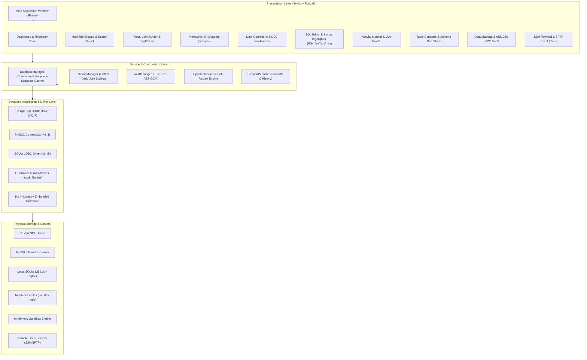

# SchemaSync System Architecture & Design

**Version:** 1.7.1  
**Author:** NSENGIYUMVA Christophe  
*Copyright © 2026 NSENGIYUMVA Christophe. All rights reserved.*

---

## Architectural Overview

SchemaSync is structured around a decoupled, thread-safe, modular desktop application architecture designed specifically for high-throughput database exploration and schema engineering without external web dependencies.



---

## Key System Layers

### 1. Presentation Layer (Swing + FlatLaf Modern Dark/Light)
* **Single-Process Lightweight GUI:** Built entirely with native Java Swing, completely eliminating the heavyweight memory overhead of Electron or Chromium runtimes.
* **Responsive Multi-Row Toolbars (`WrapLayout`):** Controls automatically wrap into clean vertical rows on smaller display resolutions and laptops, preventing toolbar clipping without requiring cumbersome submenus.
* **Syntax Highlighting & Code Folding:** Powered by `RSyntaxTextArea` with customized dark SQL themes, keyword autocompletion, block bracket matching, and line numbering.
* **Graph Visualization Engine:** Powered by `JGraphX` (mxGraph), providing GPU-accelerated canvas zooming, node panning, hierarchical tree layouts, and high-DPI export.

### 2. Service & Business Logic Layer
* **[`DatabaseManager.java`](file:///d:/projects/DBTOOL/src/main/java/com/dbtool/DatabaseManager.java):** The centralized nexus for all database interactions. Manages connection state, pooling, metadata discovery, query execution, and cache synchronization.
* **Metadata & Column Cache:** Features thread-safe `ConcurrentHashMap` caches for schema table lists, column types, and foreign key graphs, drastically minimizing expensive round-trips to the database metadata catalogs during interactive querying.
* **Query History & Draft Persistence:** Keystrokes in the SQL editor are debounced and persisted to `Documents/SchemaSyncSaves/sql_editor_draft.sql`, ensuring full crash recovery and seamless state restoration across sessions and app updates.

### 3. Threading Model & UI Concurrency
Database queries and network operations never block the Swing Event Dispatch Thread (EDT):

| Execution Type | Handler | Purpose |
| :--- | :--- | :--- |
| **GUI Events & Rendering** | **Event Dispatch Thread (EDT)** | Handles user clicks, repaints, modal dialogs, and table model updates. |
| **SQL Query Execution** | **Background Worker Threads (`SwingWorker`)** | Long-running `SELECT`, `UPDATE`, or script executions run in isolated worker threads. |
| **Telemetry & Health Polling** | **Scheduled Daemon Executors** | Periodic ping checks, connection keep-alives, and Activity Monitor queries run without UI stutter. |
| **Background Metadata Preload** | **Asynchronous Background Threads** | Tables, column names, and foreign key relations are pre-cached in the background upon connection. |

---

## Transaction Lifecycle & Rollback Traps

SchemaSync enforces stringent transaction safety rules to prevent accidental data corruption:

1. **Auto-Commit Control:**
   - The user can toggle Auto-Commit globally via the top-level toolbar.
   - When Auto-Commit is disabled, visual badges reflect the pending transaction state.
   - Dedicated **Commit** and **Rollback** buttons allow explicit transaction finalization.
2. **Script Builder Transaction Guard:**
   - When a transaction block begins (`BEGIN;` or `START TRANSACTION;`), Auto-Commit is temporarily disabled.
   - If an exception occurs on any statement inside the block, an automatic `ROLLBACK` is issued to protect database integrity, and an error report highlights the exact failing statement.
3. **Dry-Run Migration Testing:**
   - Forward (`UP`) and Rollback (`DOWN`) DDL scripts can be executed in **Dry-Run Mode**.
   - The entire script runs inside a transaction that is guaranteed to rollback before completion, verifying syntax and constraint validity against live data without altering the schema.

---

## Persistence & Directory Structure

All user configurations, query drafts, learned join rules, and encrypted vaults are kept in a dedicated, permission-safe user directory:

```
%USERPROFILE%\Documents\SchemaSyncSaves\     (Windows)
~/Documents/SchemaSyncSaves/                  (Linux)
├── sql_editor_draft.sql                      # Active SQL buffer draft
├── query_history.json                        # 100-entry persistent query log
├── saved_queries.json                        # Starred/favorited SQL snippets
├── learned_joins.properties                  # User-defined and auto-discovered table joins
└── credentials.vault                         # AES-256-GCM encrypted connections
```
