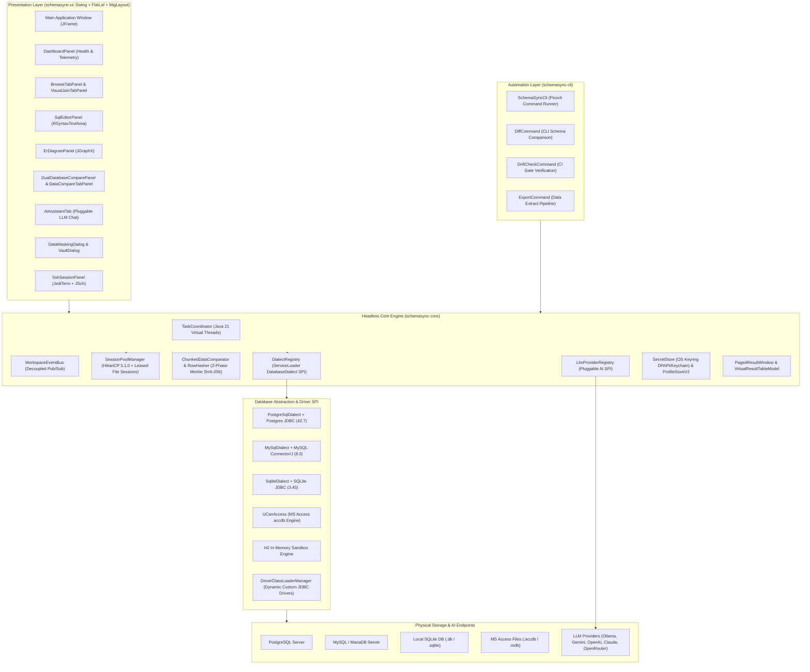

# SchemaSync System Architecture & Design

**Version:** 2.2.0  
**Author:** NSENGIYUMVA Christophe  
*Copyright © 2026 NSENGIYUMVA Christophe. All rights reserved.*

---

## Architectural Overview

SchemaSync v2.2.0 is structured as a modular, 3-module Maven reactor engineered for high-throughput database exploration, schema engineering, and CI/CD automation without external web runtime overhead:

1. **`schemasync-core` (Headless Core Engine):** 100% headless library (zero `javax.swing.*` or `java.awt.*` imports). Encapsulates connection management, HikariCP pooling, cryptographic vaults, SQL parsing, AST analysis, schema reflection, keyset pagination, and the 2-phase chunked diff engine.
2. **`schemasync-cli` (Automated CI/CD Utility):** Standalone headless CLI packaged as `schemasync-cli.jar` using Picocli 4.7.6. Executes schema diffs, drift checks, and exports in non-interactive pipelines.
3. **`schemasync-ui` (Modern Desktop Studio):** Rich desktop client utilizing FlatLaf 3.4, MigLayout 11.3 responsive forms, JGraphX ERD canvas, and docking workbench panels.



---

## Key System Layers

### 1. Headless Core Architecture (`schemasync-core`)
* **Strict Headless Isolation:** Completely free from UI toolkit dependencies, allowing seamless reuse across desktop UI, command-line interfaces, and background microservices.
* **Concurrency with Java 21 Virtual Threads:** High-volume database queries and I/O tasks execute using lightweight Java 21 Virtual Threads via `TaskCoordinator.java`, eliminating thread pool starvation and scaling to thousands of concurrent operations.
* **Deterministic Row Fingerprinting:** `CanonicalValueNormalizer` and `RowHasher` compute uniform 256-bit SHA-256 Merkle hashes across any supported database engine regardless of casing, timezone, or driver-specific object wrappers.

### 2. High-Throughput Connection Management (`SessionPoolManager`)
* **HikariCP 5.1.0 Server Pooling:** PostgreSQL and MySQL server connections use high-speed connection pools with validation timeouts, maximum lifetime management, and leak detection.
* **Thread-Safe File Engine Lease Locks:** SQLite and MS Access use synchronized lease locks to eliminate file locking bugs and concurrency crashes while permitting concurrent UI operations.
* **Dual Borrowing Semantics:** Short-lived queries borrow pooled connections with auto-close; transaction-controlled workbenches use `openPinnedSession()` to pin an unpooled connection for manual commit/rollback cycles.

### 3. Threading Model & UI Concurrency
Database queries and network operations never block the Swing Event Dispatch Thread (EDT):

| Execution Type | Handler | Purpose |
| :--- | :--- | :--- |
| **GUI Events & Rendering** | **Event Dispatch Thread (EDT)** | Handles user clicks, repaints, modal dialogs, and table model updates. |
| **SQL Query & Diff Tasks** | **Java 21 Virtual Threads (`TaskCoordinator`)** | Long-running `SELECT`, chunked data diffs, or migrations execute on lightweight virtual threads. |
| **Telemetry & Health Polling** | **Scheduled Virtual Thread Workers** | Periodic ping checks, connection keep-alives, and Activity Monitor queries run without UI stutter. |
| **Decoupled System Events** | **`WorkspaceEventBus`** | Thread-safe pub/sub dispatching schema mutations, query metrics, and connection changes across workbench tabs. |

---

## Transaction Lifecycle & Rollback Traps

SchemaSync enforces stringent transaction safety rules to prevent accidental data corruption:

1. **Auto-Commit Control:**
   - The user can toggle Auto-Commit globally via the top-level toolbar.
   - When Auto-Commit is disabled, visual badges reflect the pending transaction state.
   - Dedicated **Commit** and **Rollback** buttons allow explicit transaction finalization.
2. **Script Builder Transaction Guard:**
   - When a transaction block begins (`BEGIN;` or `START TRANSACTION;`), Auto-Commit is temporarily disabled.
   - If an exception occurs on any statement inside the block, an automatic `ROLLBACK` is issued to protect database integrity, and an error report highlights the exact failing statement.
3. **Dry-Run Migration Testing:**
   - Forward (`UP`) and Rollback (`DOWN`) DDL scripts can be executed in **Dry-Run Mode**.
   - The entire script runs inside a transaction that is guaranteed to rollback before completion, verifying syntax and constraint validity against live data without altering the schema.

---

## Persistence & Directory Structure

All user configurations, query drafts, learned join rules, and encrypted vaults are kept in a dedicated, permission-safe user directory:

```
%USERPROFILE%\Documents\SchemaSyncSaves\     (Windows)
~/Documents/SchemaSyncSaves/                  (Linux)
├── sql_editor_draft.sql                      # Active SQL buffer draft
├── query_history.json                        # 100-entry persistent query log
├── saved_queries.json                        # Starred/favorited SQL snippets
├── learned_joins.properties                  # User-defined and auto-discovered table joins
└── credentials.vault                         # AES-256-GCM encrypted connections
```
