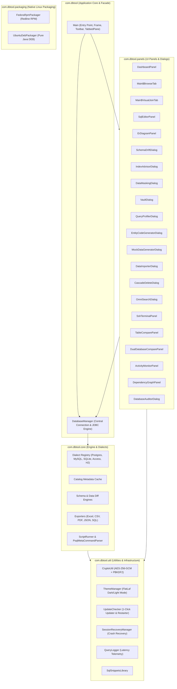

# SchemaSync Codebase, Module & Function Map

**Version:** 1.7.1  
**Creator & Lead Architect:** NSENGIYUMVA Christophe  
*Copyright © 2026 NSENGIYUMVA Christophe. All rights reserved.*

---

## 1. Architectural Map & Component Topology

SchemaSync is organized into distinct, modular Java packages that enforce clean separation between presentation, state orchestration, database metadata reflection, SQL dialect abstraction, cryptography, and native packaging:

---

## 2. Package & Class Inventory

### Package `com.dbtool` (Application Entry & Facade)

#### [`Main.java`](file:///d:/projects/DBTOOL/src/main/java/com/dbtool/Main.java)
The primary entry point, GUI shell, top-level toolbar, and main tabbed workspace coordinator:
* **`public static void main(String[] args)`**: Sets system properties (`-Duser.timezone=UTC`, font antialiasing), initializes FlatLaf modern dark theme, sets Windows AppUserModelID (`SchemaSync.DatabaseTool`) via JNA, and launches the GUI on the Event Dispatch Thread (EDT).
* **`public class BrowseTab extends JPanel`**: Encapsulates a single table browser tab.
  * `createBrowsePanel()`: Builds the responsive WrapLayout toolbar, table dropdown, and data grid.
  * `openColumnSelector()`: Opens the deduplicated column checkbox selector dialog.
  * `loadTableData()`: Executes the parameterized browse query in a background `SwingWorker` thread.
  * `buildCurrentBrowseQuery()`: Constructs the SQL `SELECT ... FROM ... WHERE ... ORDER BY ... LIMIT` query with deduplicated columns.
* **`public class VisualJoinTab extends JPanel`**: Encapsulates an interactive multi-table visual join designer.
  * `createJoinPanel()`: Constructs base table dropdowns, dynamic join rows, and condition panels.
  * `executeVisualJoin()`: Assembles the multi-table `JOIN` query and populates the results table.
  * `loadFromSql(String rawSql)`: Uses `JSqlParser` to reverse-parse an arbitrary SQL query back into visual dropdowns and condition rows.
  * `openJoinColumnSelector()`: Deduplicated column selector dialog for joined tables.
* **`private void populateTablesUI()`**: Populates the table dropdowns and tree catalog after database connection.
* **`public void setLinuxAppId()`**: Uses reflection on Linux to set `sun.awt.X11.XToolkit.awtAppClassName = "schemasync"`, binding the app to GNOME/KDE Wayland dock icons.

#### [`DatabaseManager.java`](file:///d:/projects/DBTOOL/src/main/java/com/dbtool/DatabaseManager.java)
The centralized JDBC facade managing connection state, driver instantiation, metadata caching, and SQL execution:
* **`connectExistingPostgres(host, port, db, user, pass)`**: Connects to a live PostgreSQL database via `org.postgresql.Driver`.
* **`connectMySQL(host, port, db, user, pass)`**: Connects to a live MySQL/MariaDB database via `com.mysql.cj.jdbc.Driver`.
* **`connectSQLite(filePath)`**: Opens a local SQLite database file via `org.sqlite.JDBC`.
* **`connectAccess(filePath, password)`**: Bridges to MS Access `.accdb`/`.mdb` via `UCanAccess` with `immediatelyReleaseResources=true`.
* **`connectSandbox()`**: Initializes an in-memory H2 database (`jdbc:h2:mem:sandbox`) and seeds sample relational data.
* **`getTableNames()`**: Returns a cached, sorted list of all user table names.
* **`getColumnNames(tableName)`**: Returns an ordered `LinkedHashSet` of distinct column names for a given table, eliminating multi-schema duplicate leaks.
* **`getDetailedColumns(tableName)`**: Returns comprehensive column metadata (data type, size, nullable, primary key, foreign key).
* **`preloadAllColumns()`**: Asynchronously preloads all column metadata in a background daemon thread upon connection.
* **`autoReconnect()`**: Restores a lost connection using the last known connection parameters.

---

### Package `com.dbtool.panels` (UI Workbenches & Dialogs)

#### [`DashboardPanel.java`](file:///d:/projects/DBTOOL/src/main/java/com/dbtool/panels/DashboardPanel.java)
Executive telemetry and database health dashboard:
* **`refresh()`**: Polls database connection metrics, calculates ping latency in milliseconds, and refreshes table count cards.
* **`loadCatalogStats()`**: Queries the Top 10 largest tables by byte size or row count and renders proportional percentage progress bars.

#### [`IndexAdvisorDialog.java`](file:///d:/projects/DBTOOL/src/main/java/com/dbtool/panels/IndexAdvisorDialog.java)
Database performance and index advisor:
* **`analyze()`**: Scans database foreign keys against secondary index catalogs.
* **`findUnindexedForeignKeys()`**: Flags foreign key columns that lack a corresponding single or composite index.
* **`findRedundantIndexes()`**: Identifies duplicate indexes sharing identical left-prefix columns.
* **`generateFixScript()`**: Produces executable `CREATE INDEX` DDL statements with 1-click execution.

#### [`SchemaDriftDialog.java`](file:///d:/projects/DBTOOL/src/main/java/com/dbtool/panels/SchemaDriftDialog.java)
Schema snapshot capture, drift detector, and reversible migration studio:
* **`captureSnapshot()`**: Serializes the live database schema (tables, columns, types, keys) into a `.schema.json` file.
* **`compareSnapshots(baseline, current)`**: Computes deep structural differences between two schemas.
* **`generateUpMigration()`**: Generates atomic forward DDL (`CREATE TABLE`, `ALTER TABLE ADD COLUMN`).
* **`generateDownMigration()`**: Generates inverse rollback DDL (`DROP TABLE`, `ALTER TABLE DROP COLUMN`).
* **`executeDryRun(sql)`**: Executes the migration inside an isolated transaction that automatically rolls back, verifying syntax without modifying data.

#### [`DataMaskingDialog.java`](file:///d:/projects/DBTOOL/src/main/java/com/dbtool/panels/DataMaskingDialog.java)
Sensitive data sanitization and GDPR/HIPAA compliance workbench:
* **`detectPiiCategory(columnName, sampleValues)`**: Uses regex and keyword heuristics to identify Emails, Phone Numbers, Credit Cards, Real Names, SSNs, and Salaries.
* **`applyMask(value, strategy)`**: Masks strings according to selected rules (Partial Redaction, Randomized Pseudonymization, Full Hash).
* **`exportMaskedData(format)`**: Streams sanitized records to CSV, Excel (`.xlsx`), or SQL `INSERT` files.

#### [`VaultDialog.java`](file:///d:/projects/DBTOOL/src/main/java/com/dbtool/panels/VaultDialog.java)
Enterprise AES-256-GCM credential vault manager:
* **`unlockVault(masterPassword)`**: Derives the 256-bit AES key via PBKDF2-HMAC-SHA256 and decrypts stored connection profiles.
* **`saveProfile(profile)`**: Encrypts and persists new database credentials with authenticated GCM tags.
* **`exportVault(file, exportPassword)`**: Re-encrypts the vault for secure cross-team export.
* **`lockVault()`**: Zeros out all memory arrays (`char[]`) and locks the interface.

#### [`QueryProfilerDialog.java`](file:///d:/projects/DBTOOL/src/main/java/com/dbtool/panels/QueryProfilerDialog.java)
Real-time SQL query execution profiler:
* **`logQuery(sql, durationMs, rowCount)`**: Records query metrics into a circular ring buffer.
* **`runExplain(sql)`**: Automatically executes `EXPLAIN` or `EXPLAIN ANALYZE` on the current query and displays the graphical execution plan.

#### [`ErDiagramPanel.java`](file:///d:/projects/DBTOOL/src/main/java/com/dbtool/panels/ErDiagramPanel.java)
Interactive Entity-Relationship visualizer powered by `JGraphX`:
* **`buildGraph(tables, foreignKeys)`**: Renders table vertex cards with column lists, `[PK]`, and `[FK]` badges.
* **`applyLayout(layoutType)`**: Executes Hierarchical, Organic, or Circular graph layout algorithms.
* **`exportToImage(file)`**: Renders the graph canvas to high-DPI PNG image files.
* **`exportToMermaid()`**: Generates Mermaid.js `erDiagram` syntax for markdown documentation.

#### [`DualDatabaseComparePanel.java`](file:///d:/projects/DBTOOL/src/main/java/com/dbtool/panels/DualDatabaseComparePanel.java) & [`DataCompareTabPanel.java`](file:///d:/projects/DBTOOL/src/main/java/com/dbtool/panels/DataCompareTabPanel.java)
Multi-Database & Multi-Table cross-connection compare workbench:
* **`addDatabaseEntry()`**: Adds Database A, B, C, D... to a dynamic connection pool.
* **`runSchemaComparison()`**: Inspects and compares full schema metadata across databases, producing reversible migration DDL.
* **`addDataCompareTab(title)`**: Opens independent, concurrent table and query comparison sessions.
* **`setCompareMode(mode)`**: Switches between 3 operational data diff modes:
  * `QUICK_TABLE`: Visual table selectors with automated query generation, dynamic WHERE, JOIN, and ORDER BY clauses.
  * `UNIFIED_SQL`: Single SQL editor executing ONE query across all databases simultaneously. SELECT queries compare row differences side-by-side; UPDATE, INSERT, DELETE, and DDL queries affect all databases concurrently with safety confirmations and transaction-safe multi-statement execution.
  * `CUSTOM_SQL`: Dual independent query editors (Query A vs Query B) for asymmetric SQL comparisons.
* **`runUnifiedSqlExecution()`**: Orchestrates concurrent execution across database connections, logs execution metrics into the `⚡ Execution Results (All DBs)` audit table, and computes unified row diffs.

#### [`EntityCodeGeneratorDialog.java`](file:///d:/projects/DBTOOL/src/main/java/com/dbtool/panels/EntityCodeGeneratorDialog.java)
Multi-language ORM entity generator:
* **`generateJpa(table)`**: Produces Spring Boot `@Entity` class with typed annotations.
* **`generateRecords(table)`**: Produces immutable Java 17/21 Record data carriers.
* **`generatePrisma(table)`**: Produces TypeScript Prisma schema models.
* **`generateDrizzle(table)`**: Produces TypeScript Drizzle ORM schemas.
* **`generateSqlAlchemy(table)`**: Produces Python SQLAlchemy declarative models.
* **`generatePydantic(table)`**: Produces Python Pydantic (v2) validation models.
* **`generateEfCore(table)`**: Produces C# .NET Entity Framework Core classes.

#### [`MockDataGeneratorDialog.java`](file:///d:/projects/DBTOOL/src/main/java/com/dbtool/panels/MockDataGeneratorDialog.java)
Synthetic relational data generator:
* **`generateMockRows(count)`**: Generates realistic dummy data for names, emails, dates, phones, balances, and UUIDs.
* **`sampleForeignKeys(fkConstraint)`**: Queries existing parent primary keys to ensure child foreign key columns never violate referential constraints.
* **`executeBatchInsert(rows)`**: Executes batch `PreparedStatement` inserts inside a single transaction.

#### [`CascadeDeleteDialog.java`](file:///d:/projects/DBTOOL/src/main/java/com/dbtool/panels/CascadeDeleteDialog.java)
Recursive foreign key inspector and safe cascade delete manager:
* **`buildDependencyTree(rootTable)`**: Traverses referencing foreign keys recursively down all relationship depths.
* **`generatePreviewSql(targetRowId)`**: Computes the reverse-topological order of child deletions.
* **`executeCascadeDelete()`**: Executes deletions within an atomic transaction with instant rollback on error.

#### [`OmniSearchDialog.java`](file:///d:/projects/DBTOOL/src/main/java/com/dbtool/panels/OmniSearchDialog.java)
Global database text scanner (`Ctrl+Shift+F`):
* **`startSearch(keyword)`**: Asynchronously queries all text columns across all tables in a streaming background worker.
* **`jumpToTableRecord(tableName, primaryKeyValue)`**: Directly opens the Table Browser and navigates to the matching record.

#### [`SshTerminalPanel.java`](file:///d:/projects/DBTOOL/src/main/java/com/dbtool/panels/SshTerminalPanel.java)
Integrated server terminal:
* **`connectSsh(host, port, user, keyOrPass)`**: Opens a secure SSH channel via `JSch`.
* **`createTerminalComponent()`**: Renders a full VT100/Xterm terminal inside Swing.

---

### Package `com.dbtool.util` (Infrastructure & Helpers)

#### [`CryptoUtil.java`](file:///d:/projects/DBTOOL/src/main/java/com/dbtool/util/CryptoUtil.java)
Cryptographic security core:
* **`deriveKey(password, salt)`**: Generates a 256-bit AES key using `PBKDF2WithHmacSHA256` with 100,000 iterations.
* **`encrypt(plainBytes, key)`**: Generates a 96-bit random IV and encrypts data with `AES/GCM/NoPadding` (128-bit authentication tag).
* **`decrypt(cipherBytes, key)`**: Verifies authentication tag and decrypts ciphertext into plain bytes.

#### [`ThemeManager.java`](file:///d:/projects/DBTOOL/src/main/java/com/dbtool/util/ThemeManager.java)
FlatLaf theme coordinator:
* **`init(toggleButton)`**: Detects OS preference or loads saved theme.
* **`toggleTheme(toggleButton)`**: Seamlessly toggles between `FlatMacDarkLaf` and `FlatMacLightLaf` with instant Swing tree repainting.

#### [`UpdateChecker.java`](file:///d:/projects/DBTOOL/src/main/java/com/dbtool/util/UpdateChecker.java)
1-Click in-app self-updater:
* **`checkForUpdates(parent, silent)`**: Queries GitHub Releases API for the latest version tag.
* **`isNewerVersion(remote, local)`**: Compares semantic version strings (`MAJOR.MINOR.PATCH`).
* **`performUpdateAndRestart(downloadUrl)`**: Streams the latest installer or JAR, spawns a detached platform-specific launcher script (`update_restart.bat` / `update_restart.sh`), and terminates the running JVM cleanly.

#### [`SessionRecoveryManager.java`](file:///d:/projects/DBTOOL/src/main/java/com/dbtool/util/SessionRecoveryManager.java)
Crash recovery and editor draft autosave:
* **`startAutoSaveDaemon()`**: Periodically checks for modified editor buffers.
* **`saveEditorDraft(sql)`**: Debounces and writes active SQL editor text to `Documents/SchemaSyncSaves/sql_editor_draft.sql`.
* **`loadEditorDraft()`**: Automatically restores active SQL queries upon application startup.

---

### Package `com.dbtool.packaging` (Native Linux Packaging)

#### [`UbuntuDebPackager.java`](file:///d:/projects/DBTOOL/src/main/java/com/dbtool/packaging/UbuntuDebPackager.java)
Pure Java Debian (`.deb`) package generator:
* **`buildDeb(outputDebFile)`**: Creates standard `debian-binary`, `control.tar.gz`, and `data.tar.gz` archive streams.
* Integrates `/usr/lib/schemasync/schemasync.jar`, `/usr/bin/schemasync` launcher, `.desktop` menu entry, and `/usr/share/pixmaps/` icons.

#### [`FedoraRpmPackager.java`](file:///d:/projects/DBTOOL/src/main/java/com/dbtool/packaging/FedoraRpmPackager.java)
Pure Java Fedora (`.rpm`) package generator using `Redline RPM`:
* **`buildRpm(outputRpmFile)`**: Generates standard RPM v3/v4 packages compatible with `dnf`.
* Configures dependencies (`java-headless >= 11`), `/usr/bin/schemasync`, and Wayland desktop integration attributes.
