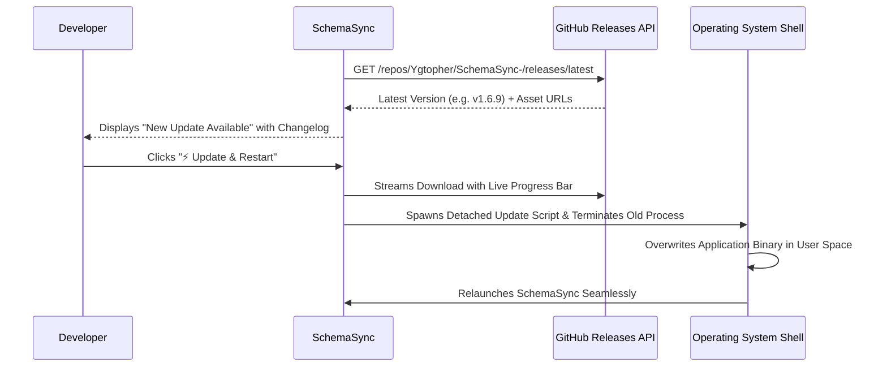

# Installation, Deployment & Packaging Guide

**Version:** 1.7.3  
**Author:** NSENGIYUMVA Christophe  
*Copyright © 2026 NSENGIYUMVA Christophe. All rights reserved.*

---

## Supported Distribution Packages

SchemaSync provides native, first-class distribution packages for Windows and major Linux distributions:

```
release/
├── SchemaSync-Setup.exe               # Windows 10/11 Inno Setup Installer (~54.5 MB)
├── SchemaSync.exe                     # Standalone Windows Launcher Wrapper (~60 MB)
├── SchemaSync.jar                     # Cross-Platform Universal Fat JAR (~59.9 MB)
├── schemasync_1.7.3_all.deb           # Debian / Ubuntu Desktop Package (~55.8 MB)
└── schemasync-1.7.3-1.fc44.noarch.rpm # Fedora / RHEL Native RPM Package (~55.7 MB)
```

---

## 1. Windows Installation (`SchemaSync-Setup.exe`)

The Windows Setup Installer provides a frictionless setup experience for Windows 10 and Windows 11:

### Installation Steps
1. Download or locate [`release/SchemaSync-Setup.exe`](file:///d:/projects/DBTOOL/release/SchemaSync-Setup.exe).
2. Double-click the installer.
3. **Automatic Java Detection & Installation:**
   - If Java 11+ is not present, Setup prompts:  
     *"SchemaSync requires Java (version 11 or higher) to run. Would you like Setup to automatically download and install Eclipse Temurin JRE 21 now?"*
   - Clicking **Yes** automatically downloads and installs the official, signed **Eclipse Adoptium Temurin JRE 21 MSI**.
4. Choose destination directory (defaults to `%LOCALAPPDATA%\Programs\SchemaSync`).
5. Setup creates Start Menu and Desktop shortcuts and launches the application.

### Windows 11 Smart App Control (SAC) Compatibility
* The installer creates shortcuts configured to launch via the digitally signed `javaw.exe` runtime.
* Because the runtime is signed by the Eclipse Foundation / Oracle Corporation, Windows 11 Smart App Control allows execution with zero security warnings or blocked process errors (Error 4551).

---

## 2. Ubuntu Desktop Linux (`.deb` Package)

Compatible with **Ubuntu 20.04, 22.04, 24.04 LTS**, Linux Mint, Debian, and all Debian-based distributions:

### Installation
Open terminal in the folder containing the `.deb` file:
```bash
sudo apt update
sudo apt install ./schemasync_1.7.3_all.deb
```
Or via `dpkg`:
```bash
sudo dpkg -i ./schemasync_1.7.3_all.deb
sudo apt-get install -f   # Resolves dependencies if needed
```

### System Integration
* **Command Line:** Run `schemasync` from any terminal.
* **Desktop Menu:** Appears in the Ubuntu Application Grid under **Development / Database**.
* **Installed Files:**
  * Application binary: `/usr/lib/schemasync/schemasync.jar`
  * Launcher script: `/usr/bin/schemasync`
  * Desktop entry: `/usr/share/applications/schemasync.desktop`
  * System icon: `/usr/share/icons/hicolor/scalable/apps/schemasync.png`

---

## 3. Fedora 44 & RHEL Linux (`.rpm` Package)

Compatible with **Fedora 38, 39, 40, 41, 44**, Red Hat Enterprise Linux (RHEL), AlmaLinux, and Rocky Linux:

### Installation
Open terminal in the folder containing the `.rpm` file:
```bash
sudo dnf install ./schemasync-1.7.3-1.fc44.noarch.rpm
```

### Wayland Dock Icon & Taskbar Binding
On modern Fedora Wayland sessions (GNOME Shell), Java Swing applications traditionally show a generic grey gear or Java coffee cup icon. SchemaSync resolves this out-of-the-box:
* The RPM package installs high-resolution icons into `/usr/share/icons/hicolor/` and `/usr/share/pixmaps/`.
* The launcher script sets JVM class attributes:
  ```bash
  exec java \
    -Dawt.useSystemAAFontSettings=on \
    -Dswing.aatext=true \
    -Duser.timezone=UTC \
    --add-opens java.desktop/sun.awt.X11=ALL-UNNAMED \
    -jar /usr/lib/schemasync/schemasync.jar "$@"
  ```
* SchemaSync's `Main.java` uses reflection on Linux to set `awtAppClassName` to `"schemasync"`, matching the `StartupWMClass=schemasync` defined in the desktop file. This ensures GNOME Shell correctly binds the running window to the dock with the high-resolution SchemaSync 3D crystal cube icon.

---

## 4. Universal Cross-Platform JAR (`SchemaSync.jar`)

The Fat JAR bundles all JDBC drivers, GUI components, and export utilities into a single portable binary.

### Prerequisites
* Java 11, 17, or 21 installed (`java -version`).

### Running
```bash
java -Duser.timezone=UTC -jar SchemaSync.jar
```

---

## 5. Unified 1-Click Update & Restart System

SchemaSync features an integrated, password-free update mechanism across all operating systems:



* **Windows:** Uses a background batch script (`update_restart.bat`) that waits for the running process to exit, copies the new binary, and relaunches `javaw.exe`.
* **Linux:** Uses a user-space updater (`update_restart.sh`) that installs into the user's local application cache, enabling silent updates without requiring `sudo` or root passwords.
