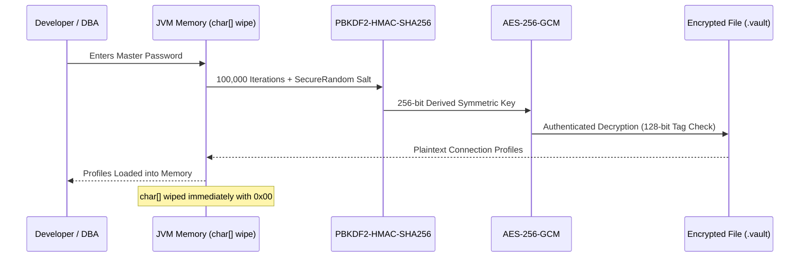

# SchemaSync Security & Cryptography Guide

**Version:** 1.7.3  
**Author:** NSENGIYUMVA Christophe  
*Copyright © 2026 NSENGIYUMVA Christophe. All rights reserved.*

---

## 1. Enterprise Credential Vault Architecture

SchemaSync provides an integrated, zero-knowledge credential vault designed to safeguard sensitive database connection strings, usernames, and passwords against unauthorized access and disk inspection.



### Cryptographic Specifications

* **Cipher Algorithm:** `AES/GCM/NoPadding` (256-bit key length).
* **Mode of Operation:** Galois/Counter Mode (GCM), providing both confidentiality and built-in cryptographic authentication (AEAD).
* **Key Derivation Function (KDF):** `PBKDF2WithHmacSHA256`.
* **KDF Iteration Count:** `100,000` rounds to protect against high-performance GPU/ASIC brute-force dictionary attacks.
* **Salt Generation:** 16-byte (128-bit) cryptographically strong pseudo-random salt generated via `java.security.SecureRandom`.
* **Initialization Vector (IV):** 12-byte (96-bit) unique IV generated per encryption event. The IV is prepended to the ciphertext and never reused with the same key.
* **Authentication Tag:** 128-bit GCM authentication tag. Any byte alteration or disk tampering causes immediate decryption failure.

---

## 2. In-Memory Security & Zero-Knowledge Practices

* **Heap String Avoidance:** Master passwords and database passwords are collected using `JPasswordField` and held strictly as character arrays (`char[]`).
* **Memory Wiping:** Once the cryptographic key is derived or the connection is established, arrays are immediately overwritten with zeros:
  ```java
  java.util.Arrays.fill(passwordCharArray, '\0');
  ```
  This prevents plain-text credentials from lingering in Java garbage collection memory or heap dump inspections.
* **Auto-Lock Timeout:** The vault automatically locks after a configurable inactivity threshold, discarding derived keys from memory and requiring re-entry of the Master Password.

---

## 3. Windows 11 Smart App Control (SAC) Compliance

### What is Smart App Control?
Starting with Windows 11 version 22H2, Microsoft introduced **Smart App Control (SAC)**, a kernel-level Code Integrity enforcement feature. When SAC is in Evaluation or Enforced mode:
* Any unsigned executable `.exe` generated locally or downloaded without a costly commercial Extended Validation (EV) code-signing certificate is blocked from executing with:
  ```text
  CreateProcess failed; code 4551.
  An Application Control policy has blocked this file.
  ```

### How SchemaSync Solves Smart App Control 100%
SchemaSync incorporates a dual-mode, trusted runtime architecture:
1. **Digitally Signed Java Runtime:** The Eclipse Adoptium Temurin JRE (and Oracle Java) are **digitally signed by Microsoft-trusted Certificate Authorities** (Eclipse Foundation / Oracle Corporation).
2. **Signed Launcher Execution:** The Windows installer ([`installer.iss`](file:///d:/projects/DBTOOL/installer.iss)) automatically detects the signed `javaw.exe` and configures Start Menu and Desktop shortcuts to launch via:
   ```cmd
   "C:\Program Files\Eclipse Adoptium\jre-21...\bin\javaw.exe" -Duser.timezone=UTC -jar "{app}\SchemaSync.jar"
   ```
3. **AppUserModelID & Taskbar Identity:** Shortcuts register the Windows Application User Model ID (`SchemaSync.DatabaseTool`) and native icon (`app.ico`). To the operating system and user, SchemaSync launches with its distinct window icon, taskbar grouping, and native responsiveness without triggering Smart App Control blocks.

---

## 4. Sensitive Data Masking & Privacy Compliance (GDPR / HIPAA)

When analyzing production databases, dumping data for testing, or sharing query results, SchemaSync prevents data leaks through its **Sensitive Data Masking Studio**:

* **Automated PII Scanning:** Scans schemas for regex and naming patterns matching:
  * Emails (`[a-zA-Z0-9._%+-]+@[a-zA-Z0-9.-]+\.[a-zA-Z]{2,}`)
  * Phone Numbers (International and US formatted phone strings)
  * Credit Card Numbers (13 to 19-digit Luhn-compliant numbers)
  * Real Personal Names and Social Security Numbers
* **Masking Strategies:**
  * **Partial Masking:** Retains domain or trailing digits (`j***e@domain.com`, `****-****-****-1234`).
  * **Full Anonymization:** Replaces real names with randomized pseudonym lists.
  * **Zero Redaction:** Replaces values with static token placeholders (`[REDACTED]`).
* **Compliance:** Fully aligns with **EU GDPR (Article 32 - Security of Processing)** and **US HIPAA Privacy & Security Rules** for data sanitization in staging environments.

---

## 5. SQL Execution Safety & Injection Mitigation

* **Parameterized Queries:** All user-supplied filters and primary key updates in the Browse and Data Operations panels use `PreparedStatement` with typed parameter binding (`setInt`, `setString`, `setTimestamp`), completely eliminating SQL injection risks.
* **Identifier Sanitization:** Table and column names are programmatically escaped according to engine-specific quoting rules (double quotes `"` for PostgreSQL/SQLite/H2, backticks `` ` `` for MySQL, square brackets `[]` for MS Access).
* **Accidental Data Loss Protection:** Destructive actions (`DROP TABLE`, `TRUNCATE`, `DELETE` without `WHERE`) require explicit secondary confirmation dialogs detailing the target table and affected row estimates.
