# Technology Stack & System Integration Guide

**Version:** 1.7.0  
**Creator & Lead Architect:** NSENGIYUMVA Christophe  
*Copyright © 2026 NSENGIYUMVA Christophe. All rights reserved.*

---

## 1. Technology Inventory & Rationale

SchemaSync leverages a curated, high-performance ecosystem of proven enterprise Java libraries, native drivers, and packaging tools. Every dependency was intentionally chosen to eliminate native overhead, avoid heavyweight web runtimes (such as Electron or Chromium), and maximize execution speed:

| Technology / Library | Version | Category | Primary Purpose in SchemaSync | Why This Over Alternatives? |
| :--- | :---: | :--- | :--- | :--- |
| **Java Platform (JDK)** | `11` (min) `21` (opt) | Core Runtime | Base language, NIO streams, concurrency, process execution | Long-Term Support (LTS), zero runtime costs, native cross-platform byte-code execution. |
| **FlatLaf** | `3.4` | UI Look & Feel | Modern Dark (`FlatMacDarkLaf`) & Light (`FlatMacLightLaf`) theme engine | Far superior to legacy Swing Metal/Nimbus; matches macOS and Windows 11 aesthetics with zero native code. |
| **JSqlParser** | `4.6` | SQL AST Engine | Parses, validates, and modifies SQL queries into Abstract Syntax Trees | Handles complex SQL grammar with ease; far more robust than error-prone regex string manipulation. |
| **JGraphX (mxGraph)** | `4.2.2` | Graph Canvas | Interactive ER Diagram layout, zooming, vertex/edge rendering | High-performance 2D graph engine; allows real-time interactive drag, zoom, and dynamic topological layouts. |
| **RSyntaxTextArea** | `3.4.0` | Code Editor | SQL query editor with syntax highlighting, bracket matching, folding | Industry-standard rich text component for Swing; includes dark themes, line numbering, and autocompletion. |
| **PostgreSQL JDBC** | `42.7.2` | Database Driver | PostgreSQL server connections, catalogs, and telemetry | Official driver; supports modern PostgreSQL 17 features, `EXPLAIN (ANALYZE)`, and multi-schema reflection. |
| **MySQL Connector/J** | `8.3.0` | Database Driver | MySQL and MariaDB connections and information schema access | Official Oracle driver; optimized for MySQL 8+, character sets, and metadata querying. |
| **SQLite JDBC** | `3.45.2.0` | Database Driver | SQLite local file queries and schema reflection | Embedded C SQLite amalgamation wrapped in a single portable JAR; requires zero server installation. |
| **UCanAccess & Jackcess** | `5.0.1` | Database Driver | Pure Java Microsoft Access (`.accdb` / `.mdb`) database bridge | Eliminates Windows ODBC dependency; enables reading and writing MS Access databases on **Linux and macOS**. |
| **H2 Database Engine** | `2.2.224` | Database Driver | In-memory Sandbox engine and SQL dump import parser | Blazing fast in-memory execution; full PostgreSQL dialect compatibility mode for instant offline testing. |
| **Apache POI OOXML** | `5.2.5` | Export Engine | Microsoft Excel (`.xlsx`) workbook generation and streaming cell data | Production-grade spreadsheet generation; formats cell data types, column widths, and header styles cleanly. |
| **OpenPDF** | `1.3.30` | Export Engine | Paginated PDF report generation for database queries | Lightweight LGPL fork of iText; produces cleanly styled, paginated tabular PDF documents without watermarks. |
| **Jackson Databind** | `2.17.1` | JSON Engine | Schema drift snapshots, vault bundles, and GitHub Releases API | Fast, type-safe JSON serialization/deserialization for complex structural metadata trees. |
| **JSch** | `0.2.16` | Remote Server | SSH port forwarding, SFTP file transfer, and remote terminal | Pure Java implementation of SSH2; supports modern ciphers, key types (RSA, ECDSA, Ed25519), and SFTP. |
| **JediTerm** | `3.74` | Terminal UI | Pure Swing VT100 / Xterm terminal emulation | Renders a full interactive Linux shell terminal directly inside a Swing JPanel. |
| **JNA (Java Native Access)**| `5.14.0` | OS Interop | Windows Taskbar pinning and AppUserModelID registration | Binds the Java window to `SchemaSync.DatabaseTool` in the Windows Shell without writing C/C++ DLLs. |
| **Java Crypto (JCA)** | `JDK 11+` | Security | AES-256-GCM encryption and PBKDF2-HMAC-SHA256 key derivation | Built-in JVM cryptographic providers; hardware-accelerated via AES-NI instructions with zero external bloat. |
| **Inno Setup** | `6.7.3` | Windows Packaging | Creates `SchemaSync-Setup.exe` with signed JRE bootstrapping | Industry-standard Windows installer with high LZMA2 compression, start menu icons, and clean uninstallers. |
| **Launch4j** | `2.5.1` | Windows Packaging | Generates native portable `SchemaSync.exe` wrapper | Provides native Windows executable headers, version resources, and custom application icons (`app.ico`). |
| **Redline RPM** | `1.2.10` | Linux Packaging | Pure Java generator for Fedora 44 `.rpm` packages | Generates standard RPMs directly during Maven builds without requiring a Fedora host or native `rpmbuild`. |
| **Apache Commons Compress** | `1.26.1` | Linux Packaging | Pure Java `.deb` package generation (`ar` and `tar.gz`) | Builds Debian packages on any operating system without requiring Debian host tools like `dpkg-deb`. |

---

## 2. How Technologies Work Together (End-to-End Workflows)

The true strength of SchemaSync lies in how these diverse technologies synergize across execution pipelines:

```mermaid
graph TD
    subgraph Workflow_Query ["1. Query & Profiling Pipeline"]
        RSyntax["RSyntaxTextArea (Editor)"] -->|User presses F5| SwingWorker["SwingWorker (Async Thread)"]
        SwingWorker -->|Executes query| Driver["JDBC Driver (PG/MySQL/SQLite/Access)"]
        Driver -->|ResultSet| Model["DefaultTableModel (Virtual Grid)"]
        Driver -->|Execution Duration| Logger["QueryLogger (Ring Buffer)"]
        Logger -->|Latency Metrics| Profiler["QueryProfilerDialog (EXPLAIN Visualizer)"]
        Model -->|Theme Styling| FlatLaf["FlatLaf Look & Feel"]
    end

    subgraph Workflow_Join ["2. Visual Join Builder Pipeline"]
        UserAction["Visual Join UI (Swing)"] -->|Assembles Clauses| JSql["JSqlParser AST Engine"]
        JSql -->|Generates Valid SQL| RSyntax
        RawSql["Raw User SQL"] -->|Reverse Parsed| JSql
        JSql -->|Populates Dropdowns & Conditions| UserAction
    end

    subgraph Workflow_ERD ["3. Interactive ER Diagram Pipeline"]
        DBMeta["DatabaseMetaData (JDBC Catalogs)"] -->|Foreign Keys & Columns| GraphX["JGraphX (mxGraph Canvas)"]
        GraphX -->|Hierarchical Layout| Java2D["Java2D Hardware Renderer"]
        GraphX -->|Image Export| PNG["High-DPI PNG Image"]
        GraphX -->|Syntax Generation| Mermaid["Mermaid.js erDiagram Markdown"]
    end

    subgraph Workflow_Masking ["4. Data Sanitization & Export Pipeline"]
        RawData["Live Table Data (JDBC)"] -->|Regex & Heuristics| PiiDetector["PII Category Detector"]
        PiiDetector -->|Applied Masking Rules| SanitizedData["Sanitized Model"]
        SanitizedData -->|POI Engine| Excel["Excel Workbook (.xlsx)"]
        SanitizedData -->|OpenPDF Engine| PDFDoc["PDF Tabular Report (.pdf)"]
        SanitizedData -->|Streaming Builder| SqlInsert["Sanitized SQL INSERT DDL"]
    end

    subgraph Workflow_Vault ["5. Enterprise Security & Credential Vault"]
        Password["User Master Password (char[])"] -->|PBKDF2-HMAC-SHA256| DerivedKey["256-bit Symmetric Key"]
        DerivedKey -->|AES-256-GCM AEAD| Cipher["Authenticated Cipher"]
        Cipher -->|Jackson Serialization| VaultFile[".schemasync.vault (Encrypted File)"]
        VaultFile -->|Authenticated Decryption| Profiles["Connection Profiles"]
        Password -.->|Memory Wiped with 0x00| HeapSecurity["Secure JVM Heap (No Plaintext)"]
    end

    subgraph Workflow_Packaging ["6. Cross-Platform Native Deployment"]
        Maven["Maven Shade Plugin (Fat JAR)"] -->|Executable JAR| CoreJar["SchemaSync.jar"]
        CoreJar -->|Inno Setup 6 + JNA| WinSetup["SchemaSync-Setup.exe (Windows 11 SAC Compliant)"]
        CoreJar -->|Launch4j Plugin| WinExe["SchemaSync.exe (Portable Windows Wrapper)"]
        CoreJar -->|Commons Compress| DebPkg["schemasync_1.6.9_all.deb (Ubuntu / Debian)"]
        CoreJar -->|Redline RPM + Reflection| RpmPkg["schemasync-1.6.9-1.fc44.noarch.rpm (Fedora Wayland)"]
    end
```

---

## 3. Deep-Dive Cross-Cutting Integration Workflows

### Integration 1: Visual Join Builder & JSqlParser AST Bidirectional Synchronization
* **The Challenge:** Users want to build complex multi-table joins visually via intuitive dropdowns, but advanced DBAs also want to write raw SQL and see the visual builder reflect their changes.
* **How They Work Together:**
  1. As the user selects tables, joins, and `ON` condition rows in Swing, SchemaSync invokes `JSqlParser`'s `PlainSelect`, `Join`, and `EqualsTo` model builders.
  2. `JSqlParser` ensures syntax formatting, parentheses grouping, and dialect escaping are 100% syntactically valid before updating `RSyntaxTextArea`.
  3. When the user pastes an existing query into the editor and clicks **"Load from SQL"**, `CCJSqlParserUtil.parse(rawSql)` decomposes the query into an AST tree.
  4. The parser identifies the base `Table`, iterates over each `Join`, extracts the `onExpression`, and dynamically creates Swing `JoinPanel` and `JoinConditionPanel` instances in real time.

### Integration 2: Interactive ER Diagramming with JDBC Metadata & JGraphX
* **The Challenge:** Generating relational diagrams requires reading disparate catalog metadata across five different database engines and rendering an interactive, high-contrast canvas that supports zooming, dragging, and exporting.
* **How They Work Together:**
  1. `DatabaseManager` queries `DatabaseMetaData.getTables()`, `getColumns()`, `getPrimaryKeys()`, and `getImportedKeys()`.
  2. The relationship graph is mapped into `JGraphX` vertex cards where primary keys are designated with `[PK]` badges and foreign keys with `[FK]` indicators.
  3. A custom `mxFastOrganicLayout` or `mxHierarchicalLayout` algorithm computes optimal node spacing and avoids edge crossings.
  4. On export, the canvas is rendered to an off-screen `BufferedImage` using `Java2D` antialiasing for high-resolution PNG generation, while an internal string builder constructs standard `Mermaid.js` Markdown for documentation.

### Integration 3: Query Profiling, Latency Telemetry & Syntax Highlighting
* **The Challenge:** Users need to know when queries are slow and why, without freezing the user interface during heavy query execution.
* **How They Work Together:**
  1. `SqlEditorPanel` hosts an `RSyntaxTextArea` editor configured with an adaptive dark SQL syntax theme.
  2. When executed (`Ctrl+Enter` or `F5`), execution is handed to a background `SwingWorker` thread.
  3. A high-resolution timer (`System.nanoTime()`) benchmarks query execution.
  4. `DatabaseManager` executes the statement and streams the results into an `UpdatableTable` wrapped in a virtualized `DefaultTableModel`.
  5. The execution metrics are logged into `QueryLogger`. If execution duration exceeds 100 ms (yellow) or 500 ms (red), visual badges alert the user.
  6. Clicking the alert automatically runs `EXPLAIN (ANALYZE)` via `QueryProfilerDialog`, rendering the database engine's query plan tree.

### Integration 4: Sensitive Data Masking & Multi-Format Exporters
* **The Challenge:** Exporting database records for test environments while ensuring compliance with GDPR Article 32 and HIPAA Privacy rules.
* **How They Work Together:**
  1. The user selects a table or executes a custom query.
  2. `DataMaskingDialog` analyzes column names and sample data using compiled regex patterns for PII detection.
  3. Once masking rules (e.g. Email anonymization, Credit Card truncation) are applied, data is rendered in a dual-grid side-by-side comparison.
  4. When the user chooses **Export to Excel**, `Apache POI` streams the rows into an `.xlsx` workbook, applying column styling and header cell formatting.
  5. When **Export to PDF** is chosen, `OpenPDF` generates an A4/Letter formatted document with headers, page numbers, and alternating row shading.
  6. When **Export to SQL** is chosen, an internal DDL builder generates clean, atomic `INSERT INTO` statements.

### Integration 5: Enterprise Credential Vault (PBKDF2 + AES-GCM + Jackson)
* **The Challenge:** Storing sensitive production credentials securely on local disks without leaving plaintext passwords in JVM heap memory.
* **How They Work Together:**
  1. The user inputs their Master Password into a `JPasswordField`, which yields a `char[]` rather than an immutable `java.lang.String`.
  2. `CryptoUtil` uses `java.security.SecureRandom` to generate a 128-bit salt and derives a 256-bit symmetric key via `PBKDF2WithHmacSHA256` running 100,000 iterations.
  3. Database profiles are serialized to JSON using `Jackson Databind`.
  4. The JSON byte payload is encrypted using `AES/GCM/NoPadding` with a 96-bit unique IV and 128-bit authentication tag.
  5. Immediately after key derivation and cipher finalization, all password character arrays are scrubbed using `Arrays.fill(charArray, '\0')`.

### Integration 6: Windows 11 Smart App Control & Signed Runtime Packaging
* **The Challenge:** Windows 11 Smart App Control (SAC) blocks unsigned `.exe` files created by Launch4j (Error 4551), but commercial EV code-signing certificates cost hundreds of dollars annually.
* **How They Work Together:**
  1. `Launch4j` wraps `SchemaSync.jar` into a portable `SchemaSync.exe` for systems with standard permissions.
  2. `Inno Setup 6` packages `SchemaSync.jar`, `SchemaSync.exe`, and `app.ico` into `SchemaSync-Setup.exe`.
  3. During setup, Inno Setup checks if a compatible Java 11+ runtime exists. If missing, it downloads and installs the official **Eclipse Adoptium Temurin JRE 21 MSI**.
  4. Because Eclipse Adoptium's `javaw.exe` is **digitally signed with a Microsoft-trusted certificate**, Windows Smart App Control allows it 100% of the time.
  5. Inno Setup dynamically scans for the signed `javaw.exe` and configures desktop shortcuts to launch `javaw.exe -Duser.timezone=UTC -jar "{app}\SchemaSync.jar"`.
  6. On startup, `Main.java` uses `JNA` to call `SetCurrentProcessExplicitAppUserModelID("SchemaSync.DatabaseTool")`, ensuring Windows groups the window correctly with its custom icon in the taskbar.

### Integration 7: Native Linux Packaging (Redline RPM & Commons Compress)
* **The Challenge:** Building native Linux `.rpm` and `.deb` packages directly on Windows without requiring Linux virtualization, Docker, or native build tools (`rpmbuild`, `dpkg-deb`).
* **How They Work Together:**
  1. `FedoraRpmPackager` uses `Redline RPM` (pure Java) to generate standard RPM v3/v4 archives containing the Fat JAR, `/usr/bin/schemasync` launcher, `.desktop` entry, and hicolor icons.
  2. `UbuntuDebPackager` uses `Apache Commons Compress` to construct `ar` archives with nested `tar.gz` data payloads matching Debian packaging standards.
  3. On launch in Linux, `Main.java` uses Java reflection to set `awtAppClassName = "schemasync"`, matching the `StartupWMClass=schemasync` defined in the desktop file. This ensures the GNOME/KDE Wayland dock binds the running window to the high-resolution SchemaSync 3D crystal cube icon.
